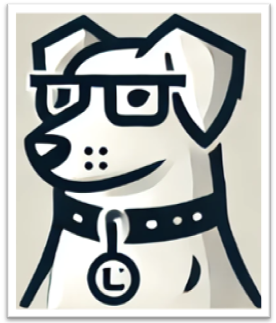

# LASSI: LLM-based Automated Self-correcting pipeline for generating parallel Scientific Codes



## What is LASSI?

LASSI translates parallel scientific GPU code between programming models with a large language model (LLM), and checks its own work. It asks the LLM for a translation, **compiles and runs** the result, and feeds every compiler or runtime error back to the LLM until the code works. This version translates between **CUDA** and **OpenMP with GPU offload**, and runs on ten applications from the [HeCBench](https://github.com/zjin-lcf/HeCBench) benchmark suite.

LASSI works with open models served locally (Ollama, LM Studio) and with hosted models through any OpenAI-compatible API. The paper evaluated four LLMs on an NVIDIA A100 and found that 80% of OpenMP-to-CUDA and 85% of CUDA-to-OpenMP translations produced the expected output.

## How It Works

For each translation, LASSI does the following (Section III of the paper):

0. **Check the environment.** The reference implementation in the *target* language is compiled and run, and its output is saved for comparison. This confirms that the compiler command and the machine work. If this step fails, LASSI stops.
1. **Build context.** A summary of programming-language knowledge for the target language (excerpts of the CUDA programming guide or the OpenMP reference card, in `lassi/prompt_dictionary.py`) is given to the LLM, which summarizes it ("self-prompting"). The LLM also describes the source code.
2. **Translate.** The language knowledge, the LLM's summary, the code description and a translation prompt are combined into one request.
3. **Compile, then self-correct.** If the code does not compile, the code and the compiler's error go back to the LLM with a request to fix it. This repeats until it compiles.
4. **Run, then self-correct.** If the compiled code fails at runtime, the same happens with the runtime error. This repeats until it runs.
5. **Save.** The generated code and a metadata file are written, including the program output and code-similarity scores against the reference.

All prompts are in [`lassi/prompt_dictionary.py`](lassi/prompt_dictionary.py).

### Optional extras

The defaults reproduce the paper (see [Reproducing the paper](#reproducing-the-paper)). These features were added afterwards and are **off unless you switch them on**:

| Feature | What it does |
|---|---|
| **LLM judge** (`--judge`) | After a translation compiles and runs, asks an LLM whether it is functionally equivalent to the reference, given both programs, their output and their runtimes. A practical screen, not a proof of correctness. |
| **Runtime records** (`--record-results`) | Appends one row per trial to a CSV: reference runtime, translated runtime and their ratio, number of self-corrections, outcome and the judge verdict. Also keeps, per trial, `environment.json`, `attempts.json` (the outcome and error of every attempt), each attempt's code and logs, and every LLM prompt and response. |
| **Repeated timing** (`--timing-repeats N`) | Times the reference and the translation N times each and reports the mean and standard deviation. The paper averaged 3 runs. The extra runs happen after the translation is finished, so they cannot change it. |
| **Repeated trials** (`--trials N`) | Repeats the whole pipeline, for example to compute pass@k. |
| **Self-correction limit** (`--max-self-corrections N`) | Gives up on a trial after N self-corrections. By default LASSI never gives up, as in the paper. |
| **Run timeout** (`--run-timeout S`) | Stops any program that runs longer than S seconds. |

## Repository Layout

- `LASSI_pipeline.ipynb`: the notebook front end. Edit one configuration cell and run.
- `run_lassi.py`: the command-line front end. It uses exactly the same code as the notebook.
- `lassi/`: the core package: `config.py` (all settings, with the paper's defaults), `pipeline.py`, `runner.py` (compile, execute, time), `metrics.py` (code similarity), `llm_backends.py`, `prompt_dictionary.py`
- `source_apps.json`: the applications and their run parameters
- `translated_code/input_codes/HeCBench/`: the benchmark sources, one folder per application, in CUDA (`<app>-cuda_main.cu`) and OpenMP (`<app>-omp_main.cpp`)
- `translated_code/<llm_source>_<model>/`: where LASSI writes its output (created on first run, not tracked by git)
- `tests/`: the reproducibility tests

## Benchmark Applications

| Category | Application | Lines (CUDA) | Run parameters |
|---|---|---|---|
| Math | matrix-rotate | 107 | `10000 1` |
| Math | jacobi | 235 | (none) |
| Language and kernel features | layout | 197 | `1` |
| Data compression and reduction | atomicCost | 116 | `1` |
| Machine learning | dense-embedding | 186 | `10000 8 1` |
| Simulation | pathfinder | 287 | `10000 1000 1000` |
| Search | bsearch | 279 | `10000 1` |
| Data encoding, decoding, or verification | entropy | 171 | `10000 1024 1` |
| Computer vision and image processing | colorwheel | 154 | `10000 8 1` |
| Bandwidth | randomAccess | 166 | `1` |

Run `python run_lassi.py --list-apps` to print this list. `entropy` includes a local header, `reference.h`; it stays in the application's source folder, is never modified, and the compiler is pointed at that folder, so only the main source file is translated.

## Getting Started

```bash
git clone https://github.com/SPEAR-UIC/LASSI.git
cd LASSI
python3 -m venv .venv
source .venv/bin/activate
pip install -r requirements.txt
```

Python 3.9 or newer is required (tested with 3.12), on Linux.

### What you need to compile and run

| You want to translate | You need |
|---|---|
| **CUDA to OpenMP, on a GPU** (the paper's setup) | the [NVIDIA HPC SDK](https://developer.nvidia.com/hpc-sdk) (`nvc++`) and an NVIDIA GPU |
| **CUDA to OpenMP, on a CPU only** | just `g++` with OpenMP. Add `--cpu` (see [No GPU?](#no-gpu-run-on-a-cpu)) |
| **OpenMP to CUDA** | CUDA's `nvcc` and an NVIDIA GPU, because the generated CUDA program has to be run |

The default compiler commands are the paper's, for an A100 (compute capability 8.0):

- CUDA: `nvcc -std=c++14 -Xcompiler -Wall -arch=sm_80 -O3`
- OpenMP: `nvc++ -Wall -O3 -Minfo -mp=gpu -gpu=cc80`

For a different GPU change the `-arch` / `-gpu` flag and, if the compiler is not on your `PATH`, give its full path (`--compiler`, `--compiler-flags`). Your GPU's compute capability is printed by `nvidia-smi --query-gpu=compute_cap --format=csv,noheader`; for example `8.9` means `-arch=sm_89` and `-gpu=cc89`.

### LLM backend setup

Choose the backend with `--llm-source` (CLI) or `llm_source` (notebook). Only the one you choose is used.

| Backend | Who can use it | What you need |
|---|---|---|
| `ollama` (default) | Anyone with a local [Ollama](https://ollama.com) server | `ollama serve`, then `ollama pull <model>` |
| `lmstudio` | Anyone with [LM Studio](https://lmstudio.ai) | start its local server in the app; set `--model` to the model's name |
| `openai_compatible` | Anyone: OpenAI, vLLM, llama.cpp server, OpenRouter, an institutional gateway, ... | `--openai-url` (default `https://api.openai.com/v1`) and an API key in the `OPENAI_API_KEY` environment variable |
| `argo` | Argonne National Laboratory staff only | the gateway's `--argo-url` and your Argonne username as `--argo-username` (the "key" is just your username, not a secret) |

Settings may also be given as environment variables: `OPENAI_API_KEY`, `OPENAI_BASE_URL`, `LASSI_ARGO_URL`, `LASSI_ARGO_USERNAME`, `OLLAMA_HOST`. Some models, such as OpenAI's reasoning models, reject a custom `temperature` or `top_p`; LASSI detects that, drops the parameter, and remembers it for the rest of the run.

## Running LASSI

### Command line

```bash
# The paper's pipeline, CUDA -> OpenMP, with a local Ollama model
python run_lassi.py --app layout --source CUDA --target OMP \
    --llm-source ollama --model codestral:22b-v0.1-q8_0

# The same through any OpenAI-compatible endpoint
export OPENAI_API_KEY=...
python run_lassi.py --app layout --llm-source openai_compatible --model gpt-4.1

# Everything on: judge, records, 3 timed runs, up to 5 trials, give up after 15 self-corrections
python run_lassi.py --app layout --llm-source ollama --model codestral:22b-v0.1-q8_0 \
    --judge --record-results --timing-repeats 3 --trials 5 --max-self-corrections 15
```

`python run_lassi.py --help` lists every option. The exit status is 0 if every trial produced working code.

### Notebook

Open `LASSI_pipeline.ipynb` (`jupyter lab`), edit the configuration cell, and run the cells top to bottom. It builds the same `Config` that the command line does.

### No GPU? Run on a CPU

OpenMP code with `target` pragmas also runs on a CPU, where the offload regions fall back to the host. CUDA code cannot run without a GPU, but LASSI only *reads* the CUDA source when translating **to** OpenMP, so that direction needs no GPU or NVIDIA compiler:

```bash
python run_lassi.py --app layout --source CUDA --target OMP --cpu \
    --llm-source ollama --model codestral:22b-v0.1-q8_0
```

`--cpu` compiles with `g++ -fopenmp -O3`. Runtimes measured this way are CPU runtimes and are **not comparable** with the paper's A100 numbers; the mode is for trying LASSI out and for checking correctness.

How long the benchmarks take on a CPU at the default parameters (measured on a 22-core workstation; yours will differ): `bsearch`, `colorwheel`, `layout`, `dense-embedding` and `matrix-rotate` finish in under a second, and `randomAccess` in about 4 seconds. `atomicCost`, `jacobi` and `pathfinder` take **longer than 30 seconds**; use `--exe-params` with smaller values (and `--run-timeout`) to keep them quick.

### Output

Each run writes to `translated_code/<llm_source>_<model>/promptset_<SOURCE>_to_<TARGET>/`:

- the generated source file, `<app>-<source>_main_translatecode_<TARGET>_exp<label>.<ext>`, and its compiled executable
- a `metadata_...txt` file: the configuration, the code-similarity scores, the program output of the reference and of the translation, their runtimes, and the number of self-corrections

With `--record-results` there is also a results CSV (`<app>_<source>2<target>_lassi_results.csv`) and, per trial, a `records/<...>_Trial<N>__<time>/` folder with `environment.json`, `attempts.json`, the code and logs of every attempt, and `llm_calls/call_NNNN/` with each prompt and response.

## Reproducing the Paper

With no optional flags, LASSI uses the settings of the paper (Dearing et al., LLMxHPC at IEEE CLUSTER 2024): the language-knowledge context and self-prompting, the prompts of Tables I to III, compile commands for an A100, the original code's sampling settings (temperature 0.2, and `top_p` 0.9 for Ollama), and self-correction until the code compiles and runs, with no limit.

- **Models (Table V):** GPT-4 Large through an API; Codestral 22B (8-bit), WizardCoder 33B (8-bit) and DeepSeek Coder v2 16B (F16), served with Ollama. Context windows: 32,768, 16,384 and 163,840 tokens respectively (`--num-ctx`).
- **Hardware:** NVIDIA A100 GPUs. Reported runtimes are the average of 3 executions: use `--timing-repeats 3`, with `--record-results` to keep the numbers.
- **The metrics in the paper's tables:** `Runtime`, `Ratio` (reference runtime divided by translated runtime) and `Self-corr` appear in the results CSV as `lassi_runtime_s`, `lassi_execute_ratio` and `lassi_selfcorrections`. The code-similarity scores are in each run's metadata file.
- **Non-determinism:** LLM output varies from run to run, so a single run will not reproduce a table cell exactly.

The reproducibility test (below) checks that the default configuration is unchanged.

## Testing

The tests are plain Python scripts; run any of them directly.

| Test | What it checks | Needs |
|---|---|---|
| `python tests/test_reproducibility.py` | With default settings, the current code sends exactly the same prompts, in the same order, and writes the same code as the original notebook (kept in `tests/legacy/`). Also covers the prompt dictionary, the notebook's shipped defaults, the command line, the optional features, run records, the self-correction limit and the program runner. The LLM is a scripted stand-in. | `g++` |
| `python tests/test_backends.py` | The LLM backends (OpenAI-compatible, LM Studio, Argo, model listing, configuration errors) against small local fake servers. | nothing |
| `python tests/test_gpu_smoke.py` | The real compile, run and timing path on a GPU in both directions: the CUDA reference with `nvcc`, the OpenMP reference offloaded to the GPU with `nvc++`, and the whole pipeline CUDA to OpenMP and OpenMP to CUDA (LLM still scripted). Skips itself if there is no GPU or compiler. | NVIDIA GPU, `nvcc`, `nvc++` |
| `python tests/test_argo_smoke.py` | One small request through the real Argo backend. Skips itself unless `LASSI_ARGO_URL` and `LASSI_ARGO_USERNAME` are set. | Argonne network |

## Adding an Application

1. Put the sources in `translated_code/input_codes/HeCBench/<app>/` as `<app>-cuda_main.cu` and `<app>-omp_main.cpp`. HeCBench nests these as `src/<app>-cuda/main.cu`, so rename the main file. Any header the program includes goes in the same folder and is included by file name only.
2. Add the application to `source_apps.json`: its `app_folder`, the `app_params` (the program's command-line arguments), and `code_lines`.
3. Run it with `--app <app>`.

LASSI translates only the main source file. The compiler is given the application's source folder as an include path, so a header such as `entropy/reference.h` is found no matter where the generated file is written.

## Related Projects

LASSI is the first in a family of tools from the SPEAR research group for LLM-based automated refactoring of parallel scientific GPU code:

- **LASSI** (this repository): translating code between parallel programming models, with a compile-and-run self-correction loop.
- **LASSI-EE**: uses the same loop to refactor code for energy efficiency, using GPU power measurements and an LLM judge.
- **LASSI-Verify**: replaces the LLM judge with empirical verification tiers, to check that a refactored kernel is equivalent to the original.

## Citation

If you use LASSI in your work, please cite:

> M. T. Dearing, Y. Tao, X. Wu, Z. Lan, and V. Taylor, "LASSI: An LLM-based Automated Self-Correcting Pipeline for Translating Parallel Scientific Codes," in *International Workshop on Large Language Models and HPC (LLMxHPC), IEEE International Conference on Cluster Computing (CLUSTER) Workshops*, 2024. DOI: [10.1109/CLUSTERWorkshops61563.2024.00029](https://doi.org/10.1109/CLUSTERWorkshops61563.2024.00029). Pre-print: [arXiv:2407.01638](https://arxiv.org/abs/2407.01638).

See [`CITATION.cff`](CITATION.cff) for a machine-readable version.

**Contact:** Matthew T. Dearing, University of Illinois Chicago, mdear2 (at) uic.edu

## License

LASSI is released under the GNU General Public License v3.0; see [`LICENSE`](LICENSE). The HeCBench sources in `translated_code/input_codes/` retain their original licenses.
